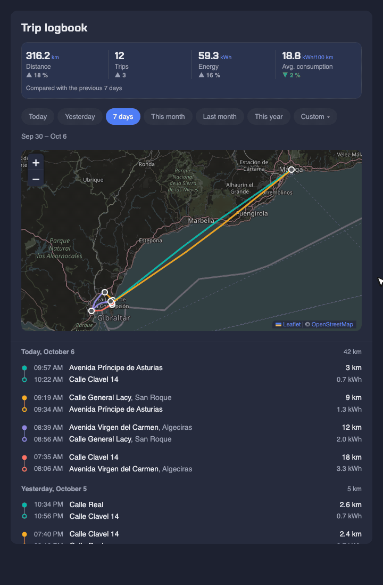
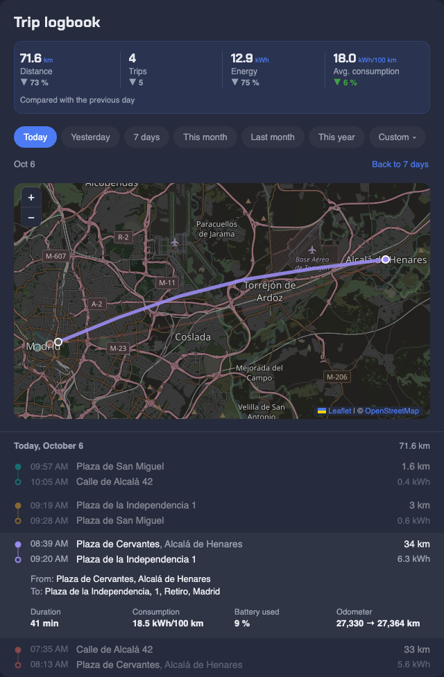
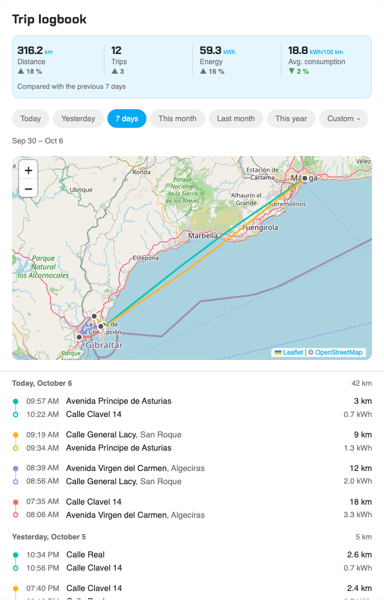

# Mercedes Trips for Home Assistant

[](https://github.com/hacs/integration)
[](https://github.com/dortizesquivel/mercedes-logbook/releases)
[](https://github.com/dortizesquivel/mercedes-logbook/actions/workflows/ci.yml)
[](https://github.com/dortizesquivel/mercedes-logbook/actions/workflows/validate.yml)
[](https://github.com/dortizesquivel/mercedes-logbook/actions/workflows/codeql.yml)
[](https://scorecard.dev/viewer/?uri=github.com/dortizesquivel/mercedes-logbook)
[](LICENSE)
[](https://www.home-assistant.io/)

**[Try it live](https://dortizesquivel.github.io/mercedes-logbook/)**: the card running in your browser, with sample trips around Madrid. **[Ideas and feedback](https://github.com/dortizesquivel/mercedes-logbook/discussions)**: tell us what it should do next.

Automatically log every trip of your Mercedes electric or plug-in hybrid in Home Assistant: start and end time, distance, energy used, the GPS route and the start and end addresses, kept in a local SQLite database that the recorder never purges.

It comes with a dashboard card: every trip on a map, quick period filters, a logbook grouped by day and stats compared with the previous period.

<p align="center">
  
</p>

| Dark theme, one trip opened | Light theme, last 7 days |
|---|---|
|  |  |

*All images use the sample trips from the [demo](#development), between public places in Madrid.*

**Contents:** [Requirements](#requirements) · [Installation](#installation) · [Configuration](#configuration) · [Features](#features) · [Dashboard card](#dashboard-card) · [Sensors](#sensors) · [REST API](#rest-api) · [Database](#database) · [Battery capacity by model](#battery-capacity-by-model) · [Troubleshooting](#troubleshooting) · [How it works](#how-it-works) · [Security](#security) · [Roadmap and feedback](#roadmap-and-feedback) · [Development](#development)

## Requirements

- **Home Assistant 2026.3 or newer.**
- **[HACS](https://hacs.xyz/)**, to install and update it from Home Assistant. Without it, [install it manually](#manual).
- **[MercedesME 2020](https://github.com/ReneNulschDE/mbapi2020)** (mbapi2020), set up with your Mercedes me account. Mercedes Trips reads the car from it: see [below](#the-mbapi2020-dependency).
- **A Mercedes electric or plug-in hybrid** with an active Mercedes me connect subscription.
- **Your car's usable battery capacity**, to work out the energy of each trip. The [table below](#battery-capacity-by-model) has the usual values.

### The mbapi2020 dependency

**This integration reads its data from [mbapi2020](https://github.com/ReneNulschDE/mbapi2020)**, a separate integration that connects your car to Home Assistant through Mercedes me. Install and set it up first.

Mercedes Trips doesn't replace it or talk to Mercedes itself: mbapi2020 shows the car's live state, and Mercedes Trips turns the changes in that state into a logbook of trips with their routes, energy and history. It uses these mbapi2020 entities:

| Entity | Example entity ID |
|---|---|
| Odometer | `sensor.<car>_odometer` |
| GPS tracker | `device_tracker.<car>_device_tracker` |
| State of charge | `sensor.<car>_state_of_charge` |
| Electric range (optional) | `sensor.<car>_range_electric` |

`<car>` is the name mbapi2020 gives your car, for example `eqb_300` or your licence plate.

To install mbapi2020, which is also in HACS's default list:

1. In HACS, search for **MercedesME 2020**, open it, select **Download** and restart Home Assistant.
2. Go to **Settings → Devices & services → Add integration → MercedesME 2020** and log in with your Mercedes me account.

## Installation

### Via HACS (recommended)

Mercedes Trips is in HACS's default list:

1. In Home Assistant, open **HACS** from the sidebar.
2. Search for **Mercedes Trips**, open it and select **Download**.
3. Restart Home Assistant, then set it up: see [Configuration](#configuration).

Or open it in HACS on your own Home Assistant with this button, then select **Download** and restart:

[](https://my.home-assistant.io/redirect/hacs_repository/?owner=dortizesquivel&repository=mercedes-logbook&category=integration)

The dashboard card comes with the integration and is registered when the integration loads, so there is no dashboard resource to add by hand, whether your dashboards are in storage or YAML mode.

**Updates:** new versions show up in HACS and under **Settings → Updates**. Install the update, restart Home Assistant and reload the browser.

### Manual

1. Download `mercedes_trips.zip` from the [latest release](https://github.com/dortizesquivel/mercedes-logbook/releases/latest).
2. Extract it into `/config/custom_components/mercedes_trips/`, so that the integration's `manifest.json` ends up at `/config/custom_components/mercedes_trips/manifest.json`. Releases published before the zip existed only have the source code archive: copy its `custom_components/mercedes_trips/` folder instead.
3. Restart Home Assistant.

The zip carries a signed build-provenance attestation, so you can check it was built by the release workflow from the tagged source: see [Security](#security).

## Configuration

1. Go to **Settings → Devices & services → + Add integration**.
2. Search for **Mercedes Trips**.
3. Check the form. If mbapi2020 is set up, your car's entities are already selected; with several cars, the first one found is picked, so check it is the right one.

| Field | Description | Default |
|---|---|---|
| Odometer sensor | The car's odometer from mbapi2020. Trips start and end on its changes | detected |
| GPS tracker | The car's `device_tracker`, for the route and the addresses | detected |
| Battery level sensor (SoC %) | State of charge, used to work out the energy of each trip | detected |
| Electric range sensor | Optional | detected |
| Usable battery capacity (kWh) | Usable (net) capacity of **your** car: see the [table below](#battery-capacity-by-model) | none, required |
| Inactivity timeout (minutes) | Minutes without the odometer changing before a trip is closed | `8` |
| Minimum trip distance (km) | Shorter trips are discarded as GPS/odometer noise | `0.5` |

Everything can be changed later from the integration's **Configure** button. Changes apply right away; trips already logged keep their values.

If your Mercedes me account reports the odometer in miles, it is converted to km when trips are stored. The distance sensors follow your Home Assistant unit system; the card always shows km.

## Features

- **Map of every trip**, each in its own colour, on OpenStreetMap, darkened when Home Assistant is in dark mode.
- **Quick periods**: today, yesterday, 7 days, this month, last month and this year, plus a custom date and hour range.
- **Stats for the period**: distance, trips, energy and average consumption, each compared with the period right before it.
- **Logbook by day**: start and end time and street, km and kWh; open a trip for the full addresses, duration, consumption, battery used and odometer.
- **Real energy use**, from the drop in state of charge and your battery's usable capacity.
- **Addresses** for the start and end of each trip, from OpenStreetMap's Nominatim (no API key), cached locally.
- **Odometer-based detection**: each stop (shopping, school, work) splits the drive into separate trips.
- **GPS route**, recorded every 30 seconds while driving.
- **English and Spanish**, following each Home Assistant user's language; dates, numbers and the 12/24-hour clock follow their profile settings.
- **Local SQLite database** and a small [REST API](#rest-api) to query it.
- **7 sensors**: distance this month and this year, energy this month, average consumption, total trips, last trip and trip in progress.

## Dashboard card

Add it from the card picker (**Mercedes Trips**) or in YAML:

```yaml
type: custom:mercedes-trips-card
title: My logbook  # optional; defaults to "Trip logbook" / "Cuaderno de ruta"
```

### Using the card

- **Pick a period** with the chips under the stats. **7 days** is the default; **Back to 7 days** returns there from any other period.
- **Custom** opens a date range and an hour range: for example, only the trips that started between 18:00 and 23:00.
- **Open a trip** by clicking it in the list or its line on the map: the map zooms to it, dims the others and the details open under the trip. Click it again to see every trip again.
- **The stats** cover the chosen period and show the change against the same number of days just before it. Lower consumption shows in green, higher in red; distance and trips stay neutral.
- **Theme and language** follow Home Assistant: dark tiles in dark mode, English or Spanish text from your profile.
- **It adapts to its own width**, so it works in a narrow sections column and on a phone.

## Sensors

| Entity | Description |
|---|---|
| `sensor.mercedes_trips_distance_this_month` | km driven in the current month |
| `sensor.mercedes_trips_distance_this_year` | km driven in the current year |
| `sensor.mercedes_trips_energy_used_this_month` | kWh used in the current month |
| `sensor.mercedes_trips_average_consumption_this_month` | Average consumption in kWh/100 km (current month) |
| `sensor.mercedes_trips_total_trips` | Number of trips logged |
| `sensor.mercedes_trips_last_trip` | Last trip as "start → end", with all its data as attributes |
| `sensor.mercedes_trips_trip_in_progress` | `active` / `idle`, with the live trip as attributes |

Names are shown in your language. Installs from before v1.4.0 keep their original (Spanish) entity IDs, such as `sensor.mercedes_trips_distancia_este_mes`.

## REST API

The integration exposes an endpoint for querying trips. The card uses it, and so can you, with a [long-lived access token](https://developers.home-assistant.io/docs/auth_api/#long-lived-access-tokens):

```
GET /api/mercedes_trips/trips
```

It needs a signed-in Home Assistant user, but **any** user, not only admins: everyone who can sign in to your Home Assistant can read every trip, with its route and addresses.

**Query parameters:**

| Parameter | Valid values | Description |
|---|---|---|
| `start_date` | `YYYY-MM-DD` | Trips that started on or after this date |
| `end_date` | `YYYY-MM-DD` | Trips that started on or before this date |
| `hour_start` | `0`–`23` | Minimum trip start hour |
| `hour_end` | `0`–`23` | Maximum trip start hour |
| `limit` | `1`–`1000` | Max results (default `200`) |
| `offset` | `0` or more | Pagination offset (default `0`) |

Hours are the local time the trip started. Any other value, such as a date in another format or an hour of 24, gets **HTTP 400**.

**Example:**

```bash
curl -H "Authorization: Bearer YOUR_TOKEN" \
  "http://homeassistant.local:8123/api/mercedes_trips/trips?start_date=2026-07-01&limit=10"
```

**Response:**

```json
{
  "trips": [
    {
      "id": 1,
      "start_time": "2026-07-12T10:00:00+02:00",
      "end_time": "2026-07-12T10:23:00+02:00",
      "distance_km": 15.4,
      "kwh_used": 3.2,
      "avg_kwh_per_100km": 20.8,
      "start_address": "Calle de Alcalá, 42, Centro, Madrid",
      "end_address": "Plaza de Cervantes, Alcalá de Henares",
      "waypoints": [[40.4183, -3.6966, "2026-07-12T10:00:00+02:00", 87.0], "..."]
    }
  ],
  "stats": {
    "distance_this_month": 342.5,
    "kwh_this_month": 71.3,
    "avg_kwh_per_100km": 20.8,
    "total_trips": 28
  },
  "active_trip": null
}
```

Each trip has every column of the database's `trips` table, so it also has its odometer readings, the state of charge before and after, and the start and end coordinates. Start and end times are local, with their UTC offset. Each waypoint is `[latitude, longitude, time, heading]`; the heading can be `null`. `active_trip` is the trip in progress, with its route so far, or `null`.

**Other endpoints:**

| Endpoint | Returns |
|---|---|
| `GET /api/mercedes_trips/trips/{id}` | One trip, with its waypoints |
| `GET /api/mercedes_trips/totals` | `trip_count`, `distance_km` and `kwh_used` for the same `start_date` / `end_date` / `hour_start` / `hour_end` filters, without waypoints |

## Database

Trips are stored in `/config/mercedes_trips.db` (SQLite), next to a cache of the addresses already looked up. You can query it directly:

```bash
sqlite3 /config/mercedes_trips.db \
  "SELECT start_time, distance_km, kwh_used, start_address, end_address FROM trips ORDER BY start_time DESC LIMIT 10;"
```

It lives in `/config`, so it goes into Home Assistant's backups with the rest of your configuration.

## Battery capacity by model

Approximate usable capacities; check the spec sheet for your model year, as they changed between versions.

| Model | Usable kWh |
|---|---|
| EQA 250 / 250+ / 300 / 350 | 66.5 kWh |
| EQB 250 / 300 / 350 | 66.5 kWh |
| EQC 400 | 80.0 kWh |
| EQE 300 / 350 / 500 | 90.6 kWh |
| EQS 450 / 580 | 107.8 kWh |
| GLC 300e PHEV | 17.6 kWh |
| C 300e PHEV | 17.6 kWh |

## Troubleshooting

**No trips appear:**

- Check that the odometer changes in **Developer tools → States** while driving.
- Make sure mbapi2020 is connected and its entities aren't `unavailable`.
- Check **Settings → System → Logs**, filtering by `mercedes_trips`.

**The card shows "Configuration error" or "Custom element doesn't exist":**

- If you opened the dashboard while Home Assistant was still starting, reload the page once it has started: a page loaded before the integration is up doesn't have the card yet.
- Otherwise hard-refresh the browser (`Ctrl+Shift+R`, or `Cmd+Shift+R` on a Mac).
- Check that **Settings → Devices & services → Mercedes Trips** shows the integration as loaded.

**Energy is not calculated:**

- The state of charge sensor must have a value (not `unknown`) at the start and end of the trip.
- Check the battery capacity in the integration options.
- If the car goes to sleep before reporting its final state of charge, that trip has no energy figure.

**mbapi2020 entities aren't pre-selected:**

- Pick them by hand in the form; look up their IDs on mbapi2020's device page.

To report a bug, use the [bug form](https://github.com/dortizesquivel/mercedes-logbook/issues/new/choose); questions go to [Q&A](https://github.com/dortizesquivel/mercedes-logbook/discussions/categories/q-a).

## How it works

1. **Trip start**: the odometer moves forward while no trip is in progress. The first reading after Home Assistant starts, or after the car comes back from `unavailable`, is only a baseline, and readings that go backwards are ignored.
2. **While driving**: a GPS point is recorded every 30 seconds, and every odometer change counts as movement.
3. **Trip end**: every 2 minutes a check closes the trip if the odometer hasn't changed for the configured timeout.
4. **After the trip**: distance and kWh are calculated, the start and end are geocoded and the trip is saved to SQLite. The sensors update.
5. **Noise filtering**: trips shorter than the minimum distance are discarded.

The trip in progress is kept in `.storage/mercedes_trips.active_trip`, so a restart in the middle of a drive doesn't lose it. A recovered trip with no movement for more than 2 hours is discarded. More detail, with the data flow, is in [docs/ARCHITECTURE.md](docs/ARCHITECTURE.md).

**What leaves your Home Assistant:** the start and end coordinates of each trip go to OpenStreetMap's Nominatim to get the addresses (once per place, then cached), and the card loads its map tiles from OpenStreetMap. Nothing else is sent anywhere: there is no telemetry, and Leaflet and the card's font ship with the integration.

**Who can see your trips:** every Home Assistant user who can sign in, through the card and the [REST API](#rest-api), not only admins. The *Last trip* sensor carries that trip's addresses and coordinates as attributes, and *Trip in progress* the start of the current one, so the recorder keeps them in its history like any other state.

**Limitations:** one car per Home Assistant install, and the card shows distances in km.

## Security

The integration runs inside Home Assistant, and the card in the browser of whoever views the dashboard, with their permissions.

- **What it reads:** the mbapi2020 entities you choose.
- **What it stores:** the trips in `/config/mercedes_trips.db`, and the trip in progress in `.storage`.
- **What it sends:** the start and end of each trip to Nominatim, for the addresses; the card loads map tiles from OpenStreetMap. No telemetry.
- **What it changes:** nothing outside its own database and sensors. It never controls the car.

Every change is checked by CodeQL, ruff, ESLint, an `npm audit` and an integrity check of the vendored Leaflet, Hypothesis fuzzing and the tests. The [OpenSSF Scorecard](https://scorecard.dev/viewer/?uri=github.com/dortizesquivel/mercedes-logbook) rates the project's practices. Every release's `mercedes_trips.zip` is signed with a build-provenance attestation, which proves it was built by the release workflow from the tagged source:

```bash
gh attestation verify mercedes_trips.zip --repo dortizesquivel/mercedes-logbook
```

Details, and how to report a vulnerability privately, are in [SECURITY.md](SECURITY.md); the reasoning behind them, from the threat model to the evidence, is in the [assurance case](docs/ASSURANCE.md). The project follows a [code of conduct](CODE_OF_CONDUCT.md) and its [governance](GOVERNANCE.md) is written down.

## Roadmap and feedback

What comes next depends on what people use it for. Vote with a 👍 on the [ideas in Discussions](https://github.com/dortizesquivel/mercedes-logbook/discussions/categories/ideas), answer the [polls](https://github.com/dortizesquivel/mercedes-logbook/discussions/categories/polls), propose your own, or show your setup in [Show and tell](https://github.com/dortizesquivel/mercedes-logbook/discussions/categories/show-and-tell). Bugs go to [issues](https://github.com/dortizesquivel/mercedes-logbook/issues/new/choose).

Planned so far:

- Several cars in one Home Assistant.
- Miles in the card, for accounts that use them.
- Exporting trips as CSV or GPX.
- An option to keep the trips API to admins.

The full [roadmap](ROADMAP.md) covers the next year, and what the project won't do.

## Development

Contributions are welcome: see [CONTRIBUTING.md](CONTRIBUTING.md) for what a pull request needs (tests for new functionality, a clean lint, the docs).

The integration, with Python 3.14 like current Home Assistant:

```bash
python3 -m venv .venv && . .venv/bin/activate
pip install -r requirements_test.txt
ruff check .                          # lint
python scripts/check_translations.py  # en.json and es.json have the same keys
pytest                                # the tests in tests/, with Hypothesis fuzzing and a coverage floor
```

The card:

```bash
npm ci
npm run lint                          # ESLint; any warning fails
npx playwright install chromium       # once
npm test                              # the Playwright browser tests in test/browser/
npm run demo                          # serves the repo: http://localhost:8765/test/demo.html
```

[`test/demo.html`](test/demo.html) runs the card in a plain browser with sample trips between public places in Madrid, no Home Assistant needed. It opens in Spanish with the dark theme; add `?lang=en`, `?theme=light` or `?w=360` (phone width).

The card isn't built: `custom_components/mercedes_trips/frontend/mercedes-trips-card.js` is the file Home Assistant serves, as written. Leaflet 1.9.4 and the Chakra Petch font are vendored in `frontend/vendor/`; the CI checks that the Leaflet copy is byte for byte the one in its npm package, and audits that version.

### Continuous integration and pull requests

`main` is protected: changes go in through a pull request, and it can only be merged when its checks pass:

- **[CI](.github/workflows/ci.yml)**: *Python tests* (ruff, the translations check, pytest with its coverage floor and Hypothesis fuzzing) and *Card tests* (`npm audit` and the integrity check of the vendored Leaflet, ESLint and the Playwright browser tests).
- **[Validate](.github/workflows/validate.yml)**: the HACS action and hassfest, which also run every week.
- **[CodeQL](.github/workflows/codeql.yml)**: static analysis of the Python, the JavaScript and the workflows.

Only the release workflow pushes to `main` directly, with a deploy key (the `DEPLOY_KEY` secret).

Layout (more in [docs/ARCHITECTURE.md](docs/ARCHITECTURE.md), with the data flow):

- `custom_components/mercedes_trips/coordinator.py`: trip detection, the SQLite database and geocoding.
- `custom_components/mercedes_trips/http_views.py`: the REST API.
- `custom_components/mercedes_trips/sensor.py`, `config_flow.py`: the sensors and the setup form.
- `custom_components/mercedes_trips/__init__.py`: setup, and serving and injecting the card.
- `custom_components/mercedes_trips/frontend/`: the card, with its vendored Leaflet and font.

### Releasing

Releases are made by the [Release workflow](.github/workflows/release.yml), from **Actions → Release → Run workflow** or:

```bash
gh workflow run release.yml -f bump=patch     # patch | minor | major
gh workflow run release.yml -f bump=minor -f dry_run=true   # try it without publishing
```

It runs the tests, bumps the version in `manifest.json`, adds the commits since the last tag to [`CHANGELOG.md`](CHANGELOG.md), commits, tags and publishes a GitHub release with `mercedes_trips.zip` and its signed build-provenance attestation. HACS offers the new version to every install from there. With `prerelease`, HACS only offers it to users who enable beta versions. Dependabot opens one grouped pull request a month for the GitHub Actions and for the dependencies.

## Contributing

Bug reports, ideas and pull requests are welcome: [CONTRIBUTING.md](CONTRIBUTING.md) says how, including the sign-off every commit needs. Everyone taking part follows the [code of conduct](CODE_OF_CONDUCT.md).

## License

[MIT](LICENSE). The vendored Leaflet is BSD 2-Clause ([licence](custom_components/mercedes_trips/frontend/vendor/LICENSE-leaflet.txt)) and the Chakra Petch font is under the SIL Open Font License 1.1 ([licence](custom_components/mercedes_trips/frontend/vendor/LICENSE-chakra-petch.txt)). Map tiles and addresses come from [OpenStreetMap](https://www.openstreetmap.org/copyright) and its contributors.

Mercedes Trips is an independent project, not affiliated with or endorsed by Mercedes-Benz. Mercedes-Benz and Mercedes me are trademarks of Mercedes-Benz Group AG.
